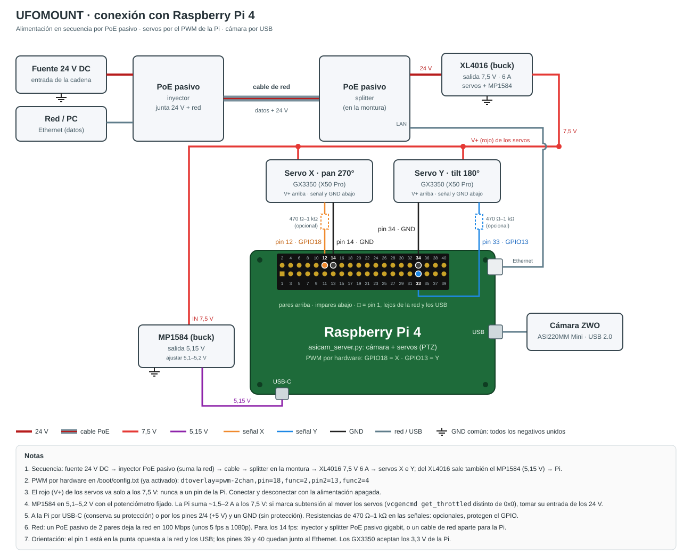

# asicam: la Raspberry como relay de video de una cámara ZWO ASI

Módulo aparte del proyecto ufomount (se fusionará más adelante con la GUI PTZ).
La Raspberry captura los cuadros **crudos** de la cámara (RAW8/RAW16, sin comprimir)
y los reenvía por red. Todo el procesamiento se hace en el PC que se conecta.

El mismo servidor también **maneja los servos de la montura** con el PWM de la Pi, en lugar
del Arduino, con el mismo protocolo que el firmware v4.1: `scripts/ptz_gui.py` /
`UfomountPTZ.exe` funcionan sin cambios (ver [Control PTZ](#control-ptz-servos)).

Probado con una **ZWO ASI220MM Mini** en una Raspberry Pi 4 con Astroberry
(Raspbian Buster de 32 bits, Python 3.7) y el SDK de ZWO 1.39.

## Estado

| Fase | Contenido | Estado |
|---|---|---|
| 1 | Servidor en la Pi: captura, control, datos, búsqueda | **hecha y verificada** |
| 2 | Librería cliente en el PC (cuadros como arreglos numpy) | **hecha y verificada** |
| 3 | Interfaz en el PC con ajustes tipo ASIStudio (`UfomountCam.exe`) | **hecha y verificada** |
| PTZ | Servos X/Y desde la Pi (reemplaza al Arduino), protocolo del firmware v4.1 | **hecho y verificado** |
| 4 | Robustez: driver 1.26 para exposiciones largas, prueba larga | pendiente |
| 5 | Servicio en la Pi (arranque automático, tiempo real) | pendiente |

## Archivos

```
asicam/
  pi/asicam_server.py     servidor (corre en la Raspberry)
  pi/zwo_sdk.py           acceso al SDK de ZWO por ctypes
  pi/fake_camera.py       cámara simulada (--simulate), para probar sin hardware
  pi/ptz.py               control de los servos (firmware v4.1 pasado a Python)
  pc/asicam_client.py     librería y línea de comandos para el PC
  pc/asicam_gui.py        interfaz: vista en vivo, histograma, ajustes, foto y video
  tools/check_server.py   verificación del servidor (protocolo crudo)
  tools/test_client.py    pruebas de la librería del PC
  tools/check_ptz.py      pruebas del control PTZ
```

El servidor solo usa la biblioteca estándar de Python (3.7 o más nuevo) y el SDK de ZWO
(`libASICamera2.so`). No instala nada. La librería del PC necesita **numpy**.

## Uso en la Raspberry

Copiar los archivos (desde la raíz del repositorio, en el PC):

```bash
scp asicam/pi/asicam_server.py asicam/pi/zwo_sdk.py asicam/pi/ptz.py astroberry@astroberry.local:asicam/
```

Arrancar el servidor en la Pi:

```bash
cd ~/asicam && python3 asicam_server.py
```

Con prioridad de tiempo real (permite más fps sin perder cuadros; requiere root). Usar un
`--config` propio para que root no se quede con el archivo de ajustes del usuario:

```bash
cd ~/asicam && sudo python3 asicam_server.py --rt --config /home/astroberry/.config/asicam/settings-rt.json
```

Opciones: `--simulate` usa una cámara simulada (ver más abajo). `--sdk RUTA` (o variable
`ASICAM_SDK`) elige la biblioteca de ZWO. Por defecto usa
la 1.39 de `~/scripts/ASI_linux_mac_SDK_V1.39/lib/armv7/` si existe, y si no, la del sistema.
Los ajustes se guardan en `~/.config/asicam/settings.json` y se recuperan al reiniciar.

**La cámara se abre solo mientras hay clientes de datos conectados.** Unos 5 s después de que
se va el último cliente, el servidor la suelta y queda libre para PHD2, KStars o INDI.

## Control PTZ (servos)

El servidor maneja los dos servos de la montura con el **PWM por hardware** de la Pi: los
pulsos los genera el chip, así que no tiemblan aunque la Pi esté ocupada con la cámara. Es el
firmware v4.1 del Arduino (`firmware/ptztest/ptztest.ino`) pasado a Python, con el mismo
protocolo, por eso la GUI PTZ (`scripts/ptz_gui.py`, `UfomountPTZ.exe`) lo encuentra con
**Buscar** y lo maneja sin cambios.



Alimentación, en secuencia: fuente de 24 V DC → inyector PoE pasivo (le suma la red) → cable
de red → splitter PoE pasivo en la montura → XL4016 a 7,5 V (6 A) → servos X e Y. De la salida
del XL4016 sale también un MP1584 ajustado a 5,1–5,2 V (5,15 V) que alimenta la Pi, por USB-C
o por los pines 2/4. La Pi suma unos 1,5–2 A a los 7,5 V: si marca subtensión al mover los
servos (`vcgencmd get_throttled` distinto de `0x0`), conviene tomar la entrada del MP1584 de
los 24 V. Con un PoE pasivo de 2 pares la red queda en 100 Mbps (unos 5 fps a 1080p); para los
14 fps hace falta PoE pasivo gigabit o un cable de red aparte para la Pi.

Señales (el rojo de los servos sigue en los 7,5 V, nunca en la Pi):

| Servo | Cable | Pin de la Pi |
|---|---|---|
| X (pan) | señal | pin 12 (GPIO18, PWM canal 0) |
| Y (tilt) | señal | pin 33 (GPIO13, PWM canal 1) |
| ambos | negativo | pin 14 o 34 (GND) |

Los GX3350 funcionan con la señal de 3,3 V de la Pi. Una resistencia de 470 Ω a 1 kΩ en serie
con cada señal protege el GPIO ante un cable mal puesto (opcional).

Hay que activar el PWM una vez en `/boot/config.txt` y reiniciar (desactiva el audio analógico):

```
dtoverlay=pwm-2chan,pin=18,func=2,pin2=13,func2=4
```

El usuario tiene que estar en el grupo `gpio` (en Astroberry ya lo está). El PTZ arranca solo
si existe `/sys/class/pwm/pwmchip0`; si algo falla, se avisa en el log y la cámara sigue
funcionando. Opciones: `--ptz off` lo desactiva, `--ptz on` hace que un fallo detenga el
servidor, `--ptz-port` cambia el puerto (5000), `--ptz-simulate` usa servos simulados con la
cámara real. Al cerrar el servidor, los servos quedan sueltos.

Diferencias con el Arduino: no hay canal USB (solo red), la Pi tarda unos 30 s en arrancar, y
la búsqueda contesta `UFOMOUNT PTZ v5.0 ... raspberry`. El resto (comandos, respuestas,
movimiento suave, límites, auto-detach, watchdog, una conexión a la vez) es igual. Ver el
protocolo en `asicam/pi/ptz.py`.

## Interfaz (UFOMOUNT CAM)

`UfomountCam.exe` (o `python asicam/pc/asicam_gui.py`). Arriba: servidor, **Buscar** y
**Conectar**. A la izquierda el video; a la derecha, como en ASIStudio:

| Sección | Qué tiene |
|---|---|
| Cámara | modelo, tamaño, bits, píxel, temperatura del sensor |
| Imagen | formato RAW8/RAW16, bin, resolución (recorte centrado) |
| Histograma | mín, máx, promedio y % saturado; escala log |
| Control | exposición (en ms, con rangos como ASIStudio y deslizador logarítmico) y ganancia, ambos con Auto |
| Avanzado | offset, ancho de banda USB (y Auto), High speed, voltear, límites del modo automático |
| Vista | estirado lineal o automático, zoom ajustar o 1:1 (doble clic; arrastrar para mover), cruz central |
| Captura | foto FITS o PGM, video `.ser` (sin límite, por segundos o por cuadros) |

Abajo: fps recibidos y mostrados, Mbit/s, huecos, descartes y reinicios del servidor, y el
valor del píxel bajo el mouse. Las fotos y videos van a `Imágenes\asicam` (se puede cambiar).
Recuerda el último servidor y las preferencias de vista en `~/.asicam_gui.json`.

El video `.ser` guarda los cuadros crudos (8 o 16 bits) con la hora de cada uno; lo abren
SER Player, PIPP, AutoStakkert, Siril, etc. Mientras se graba no se puede cambiar la geometría.

Para regenerar el ejecutable (desde la raíz del repositorio; queda en `dist/`):

```bash
python -m PyInstaller --noconfirm --onefile --windowed --name UfomountCam asicam/pc/asicam_gui.py
```

Prueba automática de la interfaz (maneja los controles como un usuario y sale con código 0 si
todo anda):

```bash
python asicam/pc/asicam_gui.py --simulate --selftest
```

```bash
python asicam/pc/asicam_gui.py --host 192.168.200.159 --selftest
```

## Uso desde el PC (librería)

```python
import sys; sys.path.insert(0, "asicam/pc")
from asicam_client import AsiCam, discover, save_fits

print(discover())                          # servidores en la red
with AsiCam("192.168.200.159") as cam:
    cam.info()                             # cámara y rangos de cada ajuste
    cam.set(exposure_us=27000, gain=0)     # en vivo; error -> AsiCamError
    cam.start()                            # recibe en segundo plano
    f = cam.get_frame(timeout=2)           # siguiente cuadro (o None)
    f.image                                # numpy (alto, ancho): uint8 o uint16
    f.pixels()                             # RAW16 -> valores reales 0..4095
    f.seq, f.timestamp, f.exposure_us, f.gain, f.temperature_c
    save_fits("foto.fits", f)              # también save_pgm(), o numpy.save()
    cam.stats()                            # fps, recibidos, huecos, descartes, reconexiones
```

- `get_frame()` entrega los cuadros en orden desde una cola corta (4 por defecto). Si el
  programa se atrasa, se descartan los más viejos (`stats()["dropped_local"]`) y el flujo sigue.
- `latest()` da el último cuadro sin esperar; `on_frame(fn)` llama a `fn(cuadro)` en el hilo
  receptor (debe ser rápida).
- Si el servidor se reinicia o se corta la red, el cliente se reconecta solo (control y datos).
- Después de un cambio de geometría, los cuadros que ya estaban en la cola llegan con el tamaño
  anterior: revisar `f.image.shape`.
- `f.latency` compara la hora de la Pi con la del PC: solo sirve si los dos relojes están en
  hora (en las pruebas, el PC iba 0,55 s atrasado y daba latencias negativas).

Línea de comandos:

```bash
python asicam/pc/asicam_client.py find
```

```bash
python asicam/pc/asicam_client.py --host 192.168.200.159 set exposure_us=27000 gain=0 auto_exposure=false
```

```bash
python asicam/pc/asicam_client.py --host 192.168.200.159 stream 10
```

```bash
python asicam/pc/asicam_client.py --host 192.168.200.159 snap foto.fits
```

Otros comandos: `info`, `status`, `get`. `snap` guarda `.fits`, `.pgm` o `.npy` según la extensión.

## Probar sin la Pi (cámara simulada)

```bash
python asicam/pi/asicam_server.py --simulate --bind 127.0.0.1 --config sim.json
```

Imita una ASI220MM Mini (mismos ajustes, ~14 fps a 1080p, RAW16 de 12 bits, punto que se
mueve, y se "traba" con ancho de banda ≥ 80 % como la real). Sirve para desarrollar la interfaz
y el procesamiento en el PC.

## Verificación

Librería del PC, con servidor simulado local (incluye reconexión):

```bash
python asicam/tools/test_client.py --simulate
```

Librería del PC contra la Pi real:

```bash
python asicam/tools/test_client.py 192.168.200.159
```

Servidor, a nivel de protocolo:

```bash
python asicam/tools/check_server.py
```

```bash
python asicam/tools/check_server.py 192.168.200.159 --stress
```

`check_server.py`: sin IP busca el servidor en la red; con IP va directo. `--quick` hace solo
lo básico; `--stress` además fuerza pérdidas de cuadros para probar la recuperación
automática. `test_client.py` acepta `--restart-cmd "programa args"` para probar la reconexión
contra la Pi. Todas las pruebas dejan los ajustes del servidor como estaban.

Control PTZ (45 pruebas: búsqueda, validación igual al firmware, movimiento suave, límites,
STOP, watchdog, auto-detach, reemplazo de conexión, canal JSON):

```bash
python asicam/tools/check_ptz.py --simulate
```

Contra la Pi **mueve los servos** (poco y despacio alrededor del centro) y los deja sueltos:

```bash
python asicam/tools/check_ptz.py 192.168.200.159
```

## Protocolo

| Puerto | Uso |
|---|---|
| 5300/UDP | búsqueda: responde a `ASICAM?` |
| 5300/TCP | control: una línea JSON por pedido y una por respuesta |
| 5301/TCP | datos: cuadros crudos, cada uno con una cabecera binaria |
| 5000/TCP | PTZ: líneas de texto del firmware de la montura (`PING`, `X 1500`, `STATUS`...) |
| 5000/UDP | PTZ búsqueda: responde a `UFOMOUNT?` |

### Búsqueda (UDP 5300)

Mandar `ASICAM?` (broadcast o directo). Respuesta: `ASICAM ` seguido de un JSON:

```json
{"server": "asicam", "version": "0.1.0", "host": "astroberry", "camera": "ZWO ASI220MM Mini",
 "control": 5300, "data": 5301, "state": "inactiva"}
```

En Windows conviene mandarlo también al broadcast de la red (`192.168.200.255`), porque
`255.255.255.255` puede salir por una interfaz virtual (Hyper-V, WSL).

### Control (TCP 5300)

Cada pedido es un objeto JSON en una línea, con `cmd` y opcionalmente `id` (se devuelve igual
en la respuesta). Toda respuesta trae `ok`; si es `false`, trae `error`. Una línea inválida no
corta la conexión.

| Comando | Qué hace |
|---|---|
| `{"cmd": "hello"}` | versión del servidor y del SDK, nombre del equipo, puertos y tamaño de la cabecera de cuadro |
| `{"cmd": "info"}` | datos de la cámara (tamaño, formatos, bins, bits) y rango de cada ajuste |
| `{"cmd": "get"}` | ajustes actuales |
| `{"cmd": "set", "settings": {...}}` | cambia uno o más ajustes; se valida todo antes de aplicar |
| `{"cmd": "status"}` | estado, fps, cuadros, descartes, reinicios, temperatura, clientes; `ptz` con la posición de los servos |
| `{"cmd": "ptz", "line": "X 1600"}` | un comando PTZ, igual que por el puerto 5000; responde `replies` con las líneas |

Ejemplo:

```
-> {"cmd": "set", "settings": {"exposure_us": 27000, "gain": 0}, "id": 7}
<- {"ok": true, "settings": {...todos los ajustes...}, "id": 7}
```

### Ajustes

Los cambios de exposición, ganancia y demás controles se aplican **en vivo** (en 0,2 s
aproximadamente). Los de geometría (formato, bin, tamaño, posición) reinician la captura
(menos de 1 s).

| Ajuste | Qué es | ASI220MM Mini |
|---|---|---|
| `image_type` | `RAW8` o `RAW16` | ambos |
| `bin` | agrupamiento de píxeles | 1 o 2 |
| `width`, `height` | tamaño del recorte; `0` = el máximo | ancho múltiplo de 8, alto par |
| `start_x`, `start_y` | esquina del recorte; `-1` = centrado | |
| `exposure_us`, `auto_exposure` | exposición en microsegundos | 32 µs a 10 s |
| `gain`, `auto_gain` | ganancia | 0 a 600 |
| `offset` | nivel de negro | 0 a 1500 |
| `bandwidth`, `auto_bandwidth` | ancho de banda USB en % | 40 a 100 |
| `high_speed` | modo High Speed (0/1) | **dejar en 0**: en 1 limita a ~10 fps |
| `flip` | 0 nada, 1 horizontal, 2 vertical, 3 ambos | |
| `auto_max_gain`, `auto_max_exp_ms`, `auto_target` | límites del modo automático | |
| `gamma`, `wb_r`, `wb_b`, `auto_wb` | solo cámaras que los tengan | no aplica (mono) |

`null` en un control significa "el valor por defecto de la cámara".

### Datos (TCP 5301)

El cliente se conecta y solo lee; no manda nada. Cada cuadro es una cabecera de 48 bytes
(little-endian, `struct` de Python `"<4sHHIdIHHHBBIHHh2xI"`) seguida de los píxeles:

| Campo | Tipo | Contenido |
|---|---|---|
| magic | 4 bytes | `ASIF` |
| version | uint16 | 1 |
| header_size | uint16 | 48 |
| seq | uint32 | número de cuadro desde que arrancó el servidor (un salto = cuadro perdido en la red) |
| timestamp | float64 | hora Unix en que la Pi recibió el cuadro (reloj de la Pi, sincronizado por NTP) |
| exposure_us | uint32 | exposición del cuadro (la real si está en automático) |
| gain | uint16 | ganancia del cuadro |
| width, height | uint16 | tamaño en píxeles |
| bin | uint8 | bin |
| image_type | uint8 | 0 = RAW8, 2 = RAW16 |
| dropped | uint32 | cuadros que el SDK descartó en total |
| restarts | uint16 | reinicios automáticos de la captura |
| flags | uint16 | bit 0 = exposición automática, bit 1 = ganancia automática |
| temp10 | int16 | temperatura del sensor × 10 (−32768 = sin dato) |
| (relleno) | 2 bytes | |
| payload_size | uint32 | bytes de píxeles que siguen |

Píxeles: fila por fila, sin relleno. RAW8 = 1 byte por píxel. RAW16 = 2 bytes little-endian;
la ASI220 entrega 12 bits **alineados arriba** (valores múltiplos de 16: dividir por 16 para
tener 0 a 4095).

Si un cliente lee más lento que la cámara, se descartan cuadros solo para ese cliente (cola de
3); los demás no se afectan.

## Recuperación ante fallas

La ASI220 Mini no tiene memoria propia: si la Pi se atrasa al leer el USB, se pierde un cuadro
y la captura puede quedar trabada. Tras 3 lecturas fallidas seguidas, el servidor reinicia la
captura sola (menos de 1 s de corte) y lo cuenta en `restarts`. Si la cámara se desconecta,
reintenta abrirla cada 2 s.

## Rendimiento medido (1080p RAW8, Pi 4, red gigabit)

| Configuración | fps | Resultado |
|---|---|---|
| Prioridad normal, ancho de banda 60 % | 12,0 | 20 s sin huecos (1 reinicio automático, sin pérdida en el cliente) |
| Tiempo real, ancho de banda 70 % | 14,0 | 60 s sin huecos ni reinicios |
| RAW16 1080p | 6,1 | |
| Recorte 1280×720 / 640×480 | 25 / 37 | |
| Ancho de banda 90 % (forzado) | ~5 | pierde cuadros, el servidor se recupera solo |

El crudo 1080p a 14 fps ocupa unos 230 Mbit/s: necesita red **gigabit**. Un inyector PoE
pasivo de 2 pares limita a 100 Mbps (unos 5,5 fps a 1080p; con bin 2 caben los 14 fps).

Moviendo los servos de ida y vuelta mientras transmite 1080p RAW8 (15 s quietos y 15 s en
movimiento, con la GUI consultando STATUS cada 0,2 s): 14,0 fps en ambos casos, sin huecos,
sin descartes del SDK y sin subtensión en la Pi.

Pendiente (fase 4): con el SDK 1.39 las exposiciones de 110 ms o más no entregan cuadros; con
el 1.26 del sistema sí.
